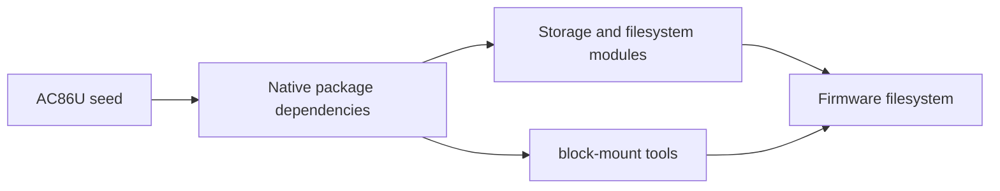

<!-- <FILE>contrib/ac86u/README.md</FILE> - <DESC>Portable AC86U build environment and CLI contracts.</DESC> -->
<!-- <VERS>VERSION: 0.1.4</VERS> -->
<!-- <WCTX>Add exFAT support to the existing removable-storage stack in RC3.</WCTX> -->
<!-- <CLOG>Document native exFAT ownership and image acceptance while advancing defaults to RC3.</CLOG> -->

# AC86U environment

Hardware support is a separate review and commit. This environment refuses configuration when the ASUS RT-AC86U profile is absent. It does not supply the hardware patches or prove hardware acceptance.

## Module plan and boundaries

The Makefile owns the portable seed/configure/firmware entrypoints, Linux-only PATH and profile guards. It invokes native OpenWrt make in OPENWRT_ROOT (default: this source checkout). It never cleans caches or supplies an external kernel tree. config.seed owns single-device selection, plain LuCI, ASUS/RT-AC86U identity and the explicit removable-storage and WireGuard package sets; normal OpenWrt networking remains upstream-owned. No calibration, credentials, keys, SSIDs or private iPXE inputs belong here. Existing .config is preserved by configure; choose a fresh checkout or reconcile it explicitly.

scripts/fnc_stamp_build_identity.py owns the identity transaction: validated CLI inputs, .config version fields, files/etc/banner, files/usr/lib/ac86u-build.json and .port ownership digests. It consumes native include/version.mk and banner templates. scripts/cls_run_stage.py owns one subprocess and its private log/status lifecycle, without shell expansion. Tests under tests/ own CLI and rendered-template acceptance checks. Neither tool admits compute: operators must use their site scheduler around make.

Identity CLI: --openwrt-root selects its own Git source tree; --run-dir is a new private directory; --variant is safe ASCII; optional --build-id explicitly repeats a known identity; --banner-label selects display text; --manufacturer and --product set OEM fields; --kernel-release is an optional observed release (null when unspecified); --dry-run validates and prints JSON without writes. Defaults retain native version number, distribution and repository. The manifest schema is 1; build_id, variant, time, upstream_commit, kernel_release, banner_sha256 and optional display/OEM fields identify the assignment. Unknown or tampered managed files, symlinks and existing run directories fail before mutation. Repeating an ID requires a fresh run directory; replacement requires matching ownership digests. Each output publishes atomically; an interrupted multi-file transaction remains inspectable and requires reconciliation, never silent recovery.

Run-stage CLI: --run-dir must be new, --cwd must exist, --label names the stage, --heartbeat-seconds must be finite and positive; the command follows --. Optional binary stdout capture uses a safe basename and optional exact byte count. --dry-run prints the invocation without effects. status.json transitions running to complete or failed, with PID, child PID, heartbeat, elapsed time, byte counters and return code. SIGTERM/interrupt terminates the owned process group; failure retains logs and partial captures. Existing artifacts are never overwritten. Scheduling, remote execution and retries remain outside this module.

Architecture checklist: only contrib/ac86u owns this environment; dependencies point toward native OpenWrt, never private host paths; borrowed cohesive identity transaction (~300 lines) and RunStage class remain together to preserve validation/publication and subprocess lifecycle invariants. Size alone does not justify changing proven logic. The two wrapper tests are adapted from the existing 14 identity tests to the native release layout; runner tests retain their original subprocess acceptance coverage.

## Removable-storage slice

`config.seed` selects `kmod-usb-storage`, `kmod-usb-storage-uas`,
`kmod-fs-ext4`, `kmod-fs-ntfs3`, `kmod-fs-exfat` and `block-mount`. Native package definitions
own SCSI, journal, checksum and character-set dependencies; the board profile
continues to own USB controller selection. NTFS3 provides kernel read/write
support. No alternate filesystem driver, network sharing, disk formatting or
custom automount policy is added. Operators explicitly configure mount entries;
existing upgraded-device configuration remains operator-owned.

```text
AC86U seed -> native Kconfig/package dependencies -> kernel modules + block
                                                        |
                                                        v
                                                 firmware filesystem
```



Implementation ownership: `config.seed` supplies package-selection inputs to
native `make defconfig`; missing packages or build failures remain native build
errors. `tests/test_build_seed.py` owns selection regressions. Apply the same
selections to the existing local `.config`, preserving its identity and other
choices. Verify dependency normalization and the rebuilt image's manifest,
modules and mount tool. Actual USB enumeration and NTFS/ext4 read/write tests
require user-operated hardware; host build checks do not prove them.
Keep these changes in the existing seed/test layout, not a new driver module.
The nohup slice is documented in [NOHUP-IMPLEMENTATION.md](NOHUP-IMPLEMENTATION.md).

## WireGuard slice

`config.seed` selects `kmod-wireguard`, `wireguard-tools` and
`luci-proto-wireguard`. Native OpenWrt packages own kernel crypto/UDP-tunnel
dependencies, the `wg` command and netifd helper; the existing LuCI feed owns
the protocol configuration UI. No custom cryptography, VPN daemon or adapter
is introduced. These packages add availability, not a tunnel: keys, peers,
interface addresses, routes and firewall permissions remain operator inputs.
No credentials, enabled interface or firewall rule is added to the image.

```text
operator LuCI/UCI configuration -> netifd + wg -> kernel WireGuard interface
```


Implementation stays in `config.seed` and the active local `.config`;
`tests/test_build_seed.py` owns the package-selection regression. Normalize
native dependencies, then verify the image manifest, `wireguard.ko`, `wg`,
netifd protocol helper and LuCI protocol asset. Native package contracts own
configuration errors and interface lifecycle; no new DTO or FSM is introduced.
Actual peer handshakes and routing require operator-provided configuration and
hardware acceptance, outside the build. Record this addition in the RC2 notes.

## RC3 exFAT increment

The existing seed owns the additional `kmod-fs-exfat=y` package selection;
native `package/kernel/linux/modules/fs.mk` owns `CONFIG_EXFAT_FS`, UTF-8
filename handling and the `kmod-nls-base` dependency. No custom filesystem,
formatting tool, automatic mount entry or sharing service is introduced.
The existing storage diagram and module boundaries above remain unchanged.
`tests/test_build_seed.py` owns the seed and RC3-default regressions. Apply the
selection to the active `.config`, normalize dependencies, and verify
`exfat.ko`, its autoload entry and package manifest in the actual RC3 image.
The native filesystem owns mount errors; on-device read/write acceptance
remains user-operated. Preserve RC1/RC2 release assets and publish RC3 only
from the committed source after image verification.

## Candidate identity

The firmware wrapper's default variant and banner label are RC3-public.
The existing identity stamper remains the authority for timestamped build IDs,
manifest fields and managed-file ownership; upstream OpenWrt version/revision
are unchanged. `tests/test_build_seed.py` checks the public wrapper help default.
The implementation changes the wrapper defaults and release notes, then verifies
RC3 in the stamped manifest and rendered firmware banner during image acceptance.
No identity schema or CLI argument changes are required.

## Operator commands

Install normal upstream OpenWrt build prerequisites and update/install the pinned release feeds using scripts/feeds before configuring. From the source root run make -f contrib/ac86u/Makefile help. configure starts only when the hardware profile exists and refuses an existing .config. firmware verifies the normalized single-device selection, stamps the identity, normalizes config again and runs native make with preserved caches. JOBS defaults to 1; set it to the scheduler allocation. RUN_DIR defaults to a unique UTC path under .port/runs; explicit directories must be new. BUILD_ID is optional; use a previous exact ID plus a fresh RUN_DIR for deliberate reproduction. BANNER_LABEL defaults to ASUS RT-AC86U 25.12.6 RC3-public. HTTPS is optional: choose packages deliberately after configuration.

Run make -f contrib/ac86u/Makefile test inside the admitted job. The Kconfig normalization test requires scripts/config/conf and reports a skip until upstream configuration tools exist. The suite also includes the hardware regressions documented in [tests/README.md](tests/README.md); the critical read-only-buffer test requires an explicit prepared pre-871 source baseline and fails clearly when that prerequisite is missing. Native ucode acceptance is a separate documented command requiring its host interpreter/modules. These tests use isolated host fixtures and do not flash or contact a router.

<!-- <FILE>contrib/ac86u/README.md</FILE> - <DESC>Portable AC86U build environment and CLI contracts.</DESC> -->
<!-- <VERS>END OF VERSION: 0.1.4</VERS> -->
